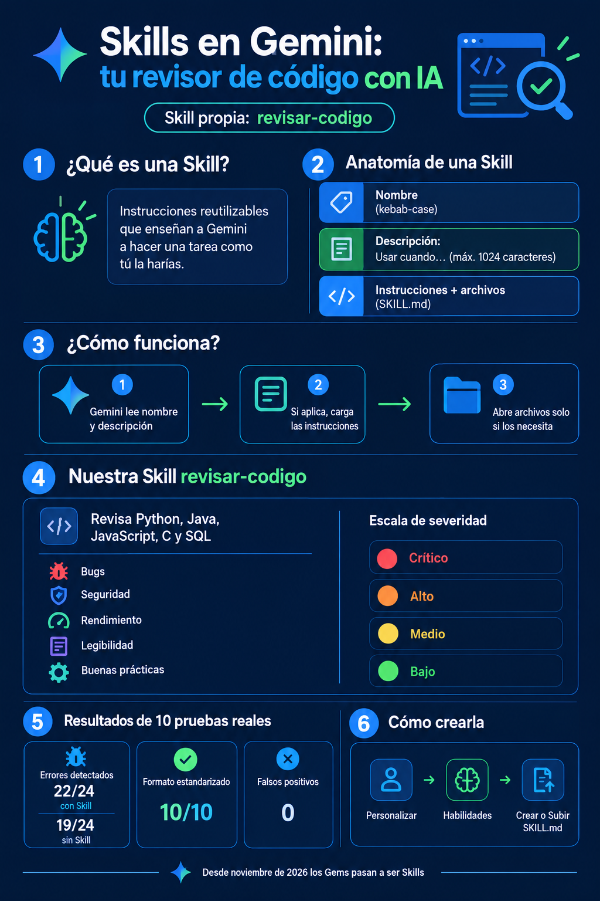

# Paso 2 — Infografía conceptual con ChatGPT

**Herramienta:** ChatGPT (chatgpt.com, generación de imágenes)
**Resultado:** [`entregables/infografia-skills-gemini.png`](../entregables/infografia-skills-gemini.png) (1024 × 1536 px)

## Objetivo

Resumir en una sola imagen qué es una Skill, cómo funciona, qué hace la nuestra y qué resultados tuvo.

## Prompt utilizado

> Crea una imagen: una infografía vertical (formato 2:3, alta resolución) en español, estilo moderno y limpio para estudiantes de Ingeniería Informática, fondo azul marino oscuro, acentos en azul y verde, iconos planos y tipografía sans serif muy legible. Título grande: 'Skills en Gemini: tu revisor de código con IA'. Subtítulo: 'Skill propia: revisar-codigo'. Secciones numeradas: 1) ¿Qué es una Skill? 'Instrucciones reutilizables que enseñan a Gemini a hacer una tarea como tú la harías'. 2) Anatomía de una Skill (3 bloques): 'Nombre (kebab-case)', 'Descripción: Usar cuando… (máx. 1024 caracteres)', 'Instrucciones + archivos (SKILL.md)'. 3) ¿Cómo funciona? flujo de 3 pasos con flechas: 'Gemini lee nombre y descripción' → 'Si aplica, carga las instrucciones' → 'Abre archivos solo si los necesita'. 4) Nuestra Skill revisar-codigo: 'Revisa Python, Java, JavaScript, C y SQL' y una checklist con 5 íconos: Bugs, Seguridad, Rendimiento, Legibilidad, Buenas prácticas; y una escala de severidad con colores: Crítico (rojo), Alto (naranja), Medio (amarillo), Bajo (verde). 5) Resultados de 10 pruebas reales con 3 tarjetas de métricas: 'Errores detectados: 22/24 con Skill vs 19/24 sin Skill', 'Formato estandarizado: 10/10', 'Falsos positivos: 0'. 6) Cómo crearla: 'Personalizar → Habilidades → Crear o Subir SKILL.md'. Pie de página: 'Desde noviembre de 2026 los Gems pasan a ser Skills'. Todo el texto debe estar bien escrito, sin errores ortográficos y sin texto inventado adicional.

## Decisiones de diseño

- **Colores:** azul marino + azul/verde para que combine con la landing page.
- **Severidades con semáforo** (rojo → verde), igual que en la Skill.
- **Datos reales:** las cifras de la sección 5 salen de nuestras pruebas (ver [cuaderno](../cuaderno/analisis_pruebas_skill.ipynb)), no son inventadas.
- Se pidió explícitamente "sin texto inventado adicional" porque los generadores de imágenes a veces agregan palabras sin sentido.

## Revisión de calidad

Revisamos la imagen ampliada sección por sección: los títulos, las 6 secciones, las métricas (22/24, 19/24, 10/10, 0) y el pie de página quedaron correctos. Se generó en el primer intento.

Captura del proceso: `capturas/07-chatgpt-infografia-generada.jpg`.
